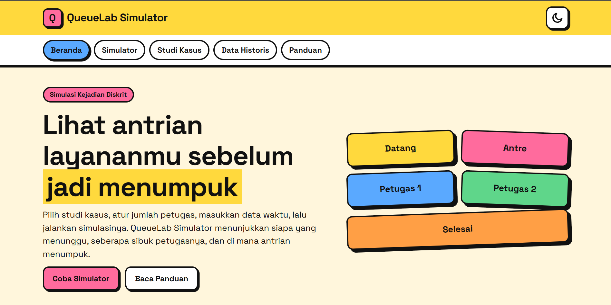
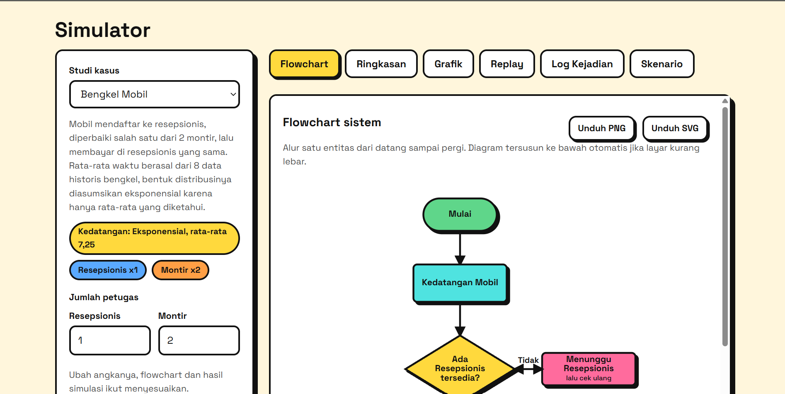
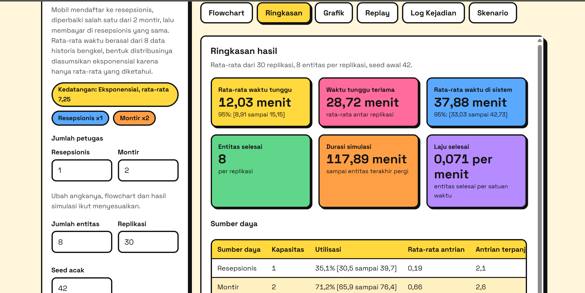
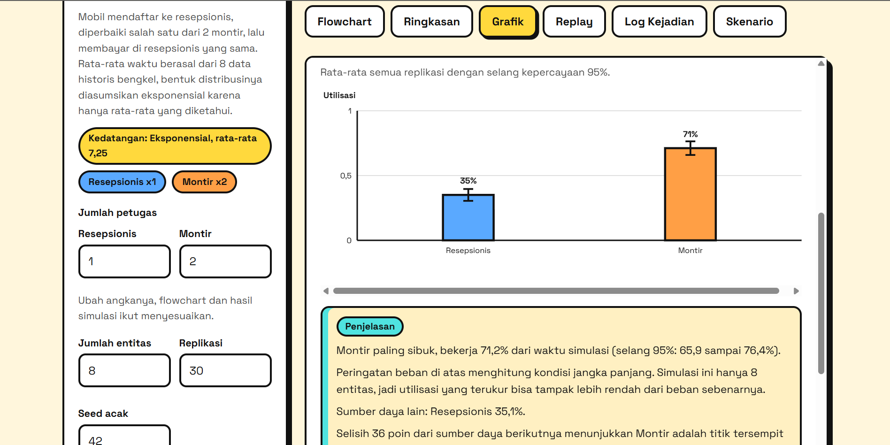
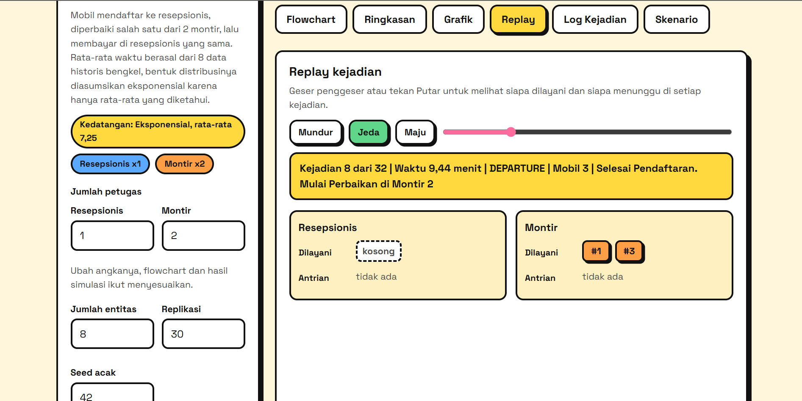
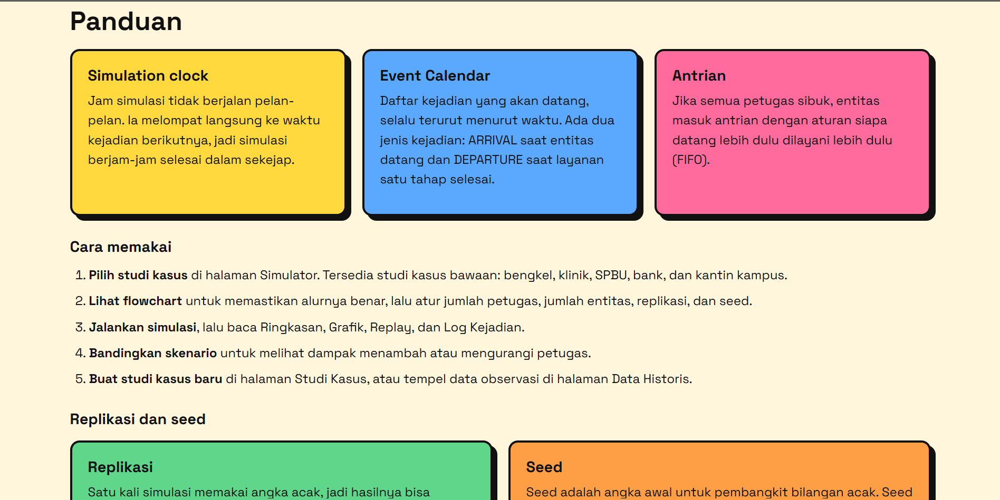

# QueueLab Simulator - Simulasi Antrean Sistem Layanan


Aplikasi web berbasis Flask untuk mensimulasikan antrean pada berbagai sistem layanan dengan metode **simulasi kejadian diskret** (discrete-event simulation). Contoh bawaannya bengkel, klinik, SPBU, bank, dan kantin kampus. Pelanggan datang, dilayani petugas secara berurutan, lalu pergi. Aplikasi menampilkan **flowchart**, grafik, dan replay kejadian, lengkap dengan penjelasan yang berubah mengikuti angka hasil simulasi. Pengguna juga bisa membuat **studi kasus baru** dan memasukkan **data historis** sendiri.

---

## Fitur Aplikasi

- **Flowchart otomatis** - diagram alur digambar dari studi kasus aktif dengan simbol standar (Terminator, Process, Decision). Disusun mendatar bila muat, dan otomatis turun ke bawah bila layar sempit. Bisa diunduh sebagai PNG atau SVG
- **Jumlah petugas bisa diatur** - di halaman Simulator, jumlah petugas tiap sumber daya diubah langsung (misalnya resepsionis dan montir pada bengkel, atau dokter dan apoteker pada klinik). Flowchart menggambar semua petugas paralel, dan penjelasan serta hasil simulasi ikut menyesuaikan
- **Istilah ikut studi kasus** - nama entitas dan petugas mengikuti studi kasus yang dipilih, jadi teks penjelasan selalu cocok dengan topiknya
- **Penjelasan replikasi dan seed** - tersedia di panel Simulator dan halaman Panduan
- **Penjelasan yang berubah** - setiap diagram dan grafik punya kotak penjelasan yang dihitung dari angka hasil simulasi, jadi kalimatnya ikut berubah saat data atau pengaturan berubah
- **Simulasi dengan replikasi** - dijalankan berulang kali, hasil dirangkum dengan rata-rata dan selang kepercayaan 95%
- **Ringkasan hasil** - waktu tunggu, waktu di sistem, utilisasi sumber daya, panjang antrean, dan laju selesai
- **Grafik** - panjang antrean dari waktu ke waktu, utilisasi, sebaran waktu tunggu, dan diagram Gantt petugas
- **Replay kejadian** - memutar ulang Event Calendar satu kejadian per satu kejadian
- **Log kejadian** - tabel kejadian terurut menurut waktu, bisa diunduh sebagai CSV
- **Skenario kapasitas** - membandingkan jumlah petugas, misalnya montir 1 sampai 4, dengan angka acak yang sama
- **Studi kasus sendiri** - tambah, ubah, salin, hapus, ekspor, dan impor studi kasus (JSON)
- **Data historis** - tempel data waktu hasil observasi, aplikasi menghitung statistik dan menyarankan distribusi
- **Peringatan beban** - muncul bila sumber daya melebihi kapasitas sehingga antrean akan terus memanjang
- **Tema terang dan gelap** - tema terang menjadi bawaan, tombol ikon matahari dan bulan untuk berganti. Tampilan menyesuaikan desktop dan mobile

---

## Teknologi

| Komponen | Teknologi |
|---|---|
| Backend | Flask 3.1 |
| Mesin simulasi | Python (pustaka standar), Event Calendar berbasis list |
| Frontend | HTML (Jinja2), CSS, JavaScript ES Modules |
| Grafik dan flowchart | SVG yang digambar dengan JavaScript |
| Penyimpanan studi kasus | localStorage peramban |
| Font | Space Grotesk dan Space Mono (dihosting di folder static) |
| Desain | Neubrutalism |

---

## Studi Kasus Bawaan

| Studi kasus | Isi |
|---|---|
| Bengkel Mobil | 8 mobil, 1 resepsionis dan 2 montir. Rata-rata waktu berasal dari data historis bengkel |
| Bengkel Ramai | 60 mobil dengan waktu layanan berdistribusi normal, 1 resepsionis dan 2 montir |
| Bengkel Ramai 3 Montir | Sama dengan Bengkel Ramai, montir ditambah menjadi 3 |
| Bengkel Ramai dengan Kasir | Pembayaran dipisah ke kasir sendiri, sehingga resepsionis hanya mengurus pendaftaran |
| Klinik Pratama | 40 pasien: pendaftaran, 2 dokter, lalu apotek |
| SPBU | 50 kendaraan: 3 pompa, lalu kasir |
| Bank | 40 nasabah: 2 teller, lalu customer service |
| Kantin Kampus | 60 mahasiswa: kasir, lalu 3 juru masak |

Pada studi kasus Bengkel Mobil, hanya **rata-rata** waktu yang berasal dari data historis. Bentuk distribusi (eksponensial) adalah asumsi. Beban montir di atas 100%, jadi antrean memanjang dan aplikasi menampilkan peringatan. Angka pada Klinik, SPBU, Bank, dan Kantin hanyalah contoh untuk latihan dan perlu diganti dengan data observasi sendiri.

---

## Cara Kerja Simulasi

Mesin mengikuti struktur klasik simulasi kejadian diskret:

1. **Inisialisasi** - jam simulasi `clock = 0`, antrean kosong, Event Calendar berisi kedatangan pertama
2. **Main simulation loop** - selama kalender tidak kosong, ambil kejadian paling awal lalu majukan jam
3. **Event handler** - kedatangan: langsung dilayani bila ada petugas tersedia, jika tidak masuk antrean. Selesai layanan: ambil entitas berikutnya dari antrean, lalu jadwalkan tahap berikutnya
4. **Statistik akhir** - hitung rata-rata waktu tunggu, utilisasi, dan panjang antrean

Alur satu mobil: Kedatangan, Pendaftaran, cek montir tersedia, Perbaikan (atau Menunggu lalu cek ulang), Pembayaran, Kepergian. Pendaftaran dan pembayaran memakai resepsionis yang sama pada studi kasus bawaan.

---

## Validasi Mesin Simulasi

| Pengujian | Hasil |
|---|---|
| Satu petugas, data berurutan | Rata-rata tunggu 0,8 menit dan selesai di menit 14, sama dengan hitungan tangan |
| Implementasi pembanding satu server (NumPy, seed 42) | Hasil sama dengan mesin ini. Uji dilewati otomatis jika NumPy tidak terpasang |
| Seed sama | Hasil selalu sama |
| Utilisasi | Selalu di antara 0 dan 1 |
| Teks penjelasan grafik | 12 uji Node memastikan kalimat berubah sesuai angka |

---

## Instalasi Lokal

### 1. Clone repository

```bash
git clone https://github.com/Alnazh/queuelab-simulator.git
cd queuelab-simulator
```

### 2. Buat virtual environment

```bash
python -m venv venv

# Windows (PowerShell, jika muncul error execution policy:
# Set-ExecutionPolicy -Scope Process Bypass)
venv\Scripts\activate

# Linux / macOS
source venv/bin/activate
```

### 3. Install dependencies

```bash
pip install -r requirements.txt
```

### 4. Jalankan aplikasi

```bash
python app.py
```

Buka browser di `http://127.0.0.1:5000`

### 5. Jalankan tes (opsional)

```bash
python -m unittest discover tests
node --test tests/insights.test.mjs
```

Perintah kedua butuh Node.js dan hanya menguji teks penjelasan grafik.

---

## Struktur Project

```
queuelab-simulator/
├── app.py                      # Entry point Flask dan rute API
├── requirements.txt            # Daftar dependensi Python
├── Procfile                    # Konfigurasi server produksi
├── .gitignore
│
├── simulation/                 # Mesin simulasi (Python)
│   ├── engine.py               # Event Calendar dan main simulation loop
│   ├── distributions.py        # Pembangkit waktu acak
│   ├── case_model.py           # Model dan validasi studi kasus
│   ├── runner.py               # Replikasi, ringkasan, skenario kapasitas
│   ├── analyzer.py             # Analisis data historis
│   ├── statistics_utils.py     # Rata-rata dan selang kepercayaan
│   ├── presets.py              # Pembaca studi kasus bawaan
│   └── errors.py               # Galat validasi
│
├── data/
│   └── presets.json            # Studi kasus bawaan
│
├── templates/                  # HTML (Jinja2)
│   ├── index.html
│   └── partials/               # Beranda, Simulator, Studi Kasus, Data, Panduan
│
├── static/
│   ├── css/                    # Token tema, layout, komponen, diagram
│   ├── js/                     # Modul JavaScript per fitur
│   └── fonts/                  # Space Grotesk dan Space Mono
│
├── tests/
│   ├── test_simulation.py      # Unit test mesin dan API (Python)
│   └── insights.test.mjs       # Uji teks penjelasan grafik (JavaScript)
│
└── docs/
    └── screenshots/            # Tangkapan layar aplikasi
```

---

## Tampilan Aplikasi

### Beranda


### Flowchart Sistem Bengkel


### Ringkasan Hasil


### Grafik


### Replay Kejadian


### Panduan



---

## Cara Penggunaan

1. Buka halaman **Simulator**, lalu pilih studi kasus. Flowchart langsung tergambar
2. Atur jumlah entitas, replikasi, dan seed acak
3. Klik **Jalankan Simulasi**, lalu lihat tab Ringkasan, Grafik, Replay, dan Log Kejadian
4. Baca kotak **Penjelasan** di bawah tiap grafik. Isinya berubah sesuai hasil simulasi
5. Buka tab **Skenario** untuk membandingkan jumlah montir
6. Untuk kasus baru, buka **Studi Kasus** lalu klik **Buat Baru**. Isi kedatangan, sumber daya, dan tahap layanan
7. Untuk data sendiri, buka **Data Historis**, tempel data waktu, klik **Analisis Data**, lalu **Terapkan**

---

## Keterbatasan

- Hasil bergantung pada data masukan. Pada studi kasus bawaan, bentuk distribusi adalah asumsi
- Saran distribusi dari data historis hanya panduan awal. Pada data sedikit, beberapa distribusi bisa sama-sama cocok
- Antrean memakai aturan First-In First-Out dan tidak ada pembatalan atau prioritas
- Pendaftaran dan pembayaran memakai satu sumber daya yang sama. Jika dipisah, ubah lewat Studi Kasus
- Studi kasus pengguna disimpan di peramban masing-masing, bukan di server
